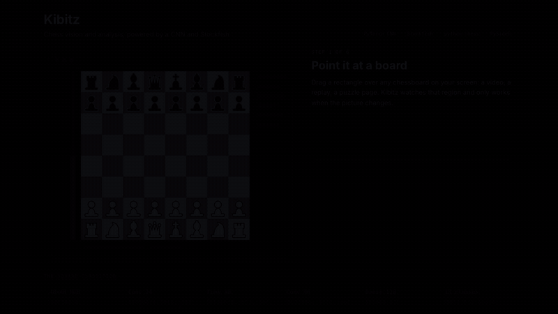

# Kibitz

*Chess vision and analysis, powered by a CNN and Stockfish.*

> In chess, to "kibitz" is to watch a game and comment on it. That's what this app does: it watches the board on your screen and tells you what the engine thinks.

Kibitz is a desktop app that **looks at a chessboard on your screen, understands the position with a small neural network, and hands it to Stockfish for analysis.**

You point it at a board, train a tiny vision model on your own board theme (training runs locally on your CPU), and from then on it follows the game, detects moves, and shows the engine's top three lines with arrows and an evaluation bar.

---

## See it in action



*Drag a box over any board, Kibitz slices it into 64 squares, the CNN reads each one, `python-chess` tracks the moves, and Stockfish shows its top three lines.*

   

---

## Why this project exists

I built this for two reasons:

1. **To get more out of Stockfish.** Stockfish is incredible, but it only speaks in FEN strings and UCI commands. Most of the time the position I want to study is on a screen: a video, a PDF, a replay, a puzzle site. This project closes that gap by giving the engine "eyes", so any board I can see can be analysed without retyping anything.
2. **As hands-on practice in AI engineering.** The vision side is a convolutional neural network (CNN) that I designed, trained, and wired into a real application: data generation, model design, training, evaluation, inference, and a responsive UI around it.

### Fair play, please

This is a **study and analysis tool, not a cheating tool.** It is not meant to be used for assistance in live or rated games on Chess.com, Lichess, or any other platform. Doing so breaks their fair-play rules and ruins the game for the other person.

> **Warning:** Using this tool (or any engine assistance) during a live game on platforms like Chess.com or Lichess can get your account **disabled or permanently banned**. These sites actively detect engine use. You use this software at your own risk and are fully responsible for how you use it.

Good uses:

- Reviewing your own finished games
- Studying master games, lectures, and video courses
- Solving and checking puzzles
- Analysing positions from books and PDFs
- Playing against a local engine or a friend over the board and reviewing afterwards

If you're ever unsure, wait until the game is over and analyse it then.

---

## How it works

```
 screen region ──► split into 64 squares ──► CNN classifies each square ──► 8x8 grid
                                                                              │
   Stockfish (top 3 lines) ◄── python-chess (legal-move tracking) ◄───────────┘
            │
            └──► board + arrows + evaluation bar + engine lines
```

1. **Capture.** You drag a rectangle over the board. The app grabs that region about 2.5 times per second and only does work when the picture actually changes.
2. **Vision (CNN).** The board image is cut into 64 squares. Each square goes through a small CNN that predicts one of 13 classes: empty, or one of 12 pieces (6 white, 6 black).
3. **Move tracking.** Instead of trusting every frame blindly, the app uses `python-chess` to ask: *is there a legal move (or two) that explains what I now see?* If yes, it plays it. If the screen shows something no legal move explains, it waits for the same reading on consecutive frames and then resyncs to the screen.
4. **Analysis.** The position is sent to Stockfish on a background thread, so the UI never freezes. The three best lines are drawn as arrows and listed with their evaluations.

### The CNN

| | |
|---|---|
| Input | 48×48 RGB crop of one square |
| Architecture | 3 × (Conv 3×3 → BatchNorm → ReLU → MaxPool), channels 24 → 48 → 96 |
| Head | Flatten → Dropout(0.3) → Linear(3456, 128) → ReLU → Linear(128, 13) |
| Output | 13 classes: `.` `P N B R Q K` `p n b r q k` |
| Optimiser | Adam, learning rate 2e-3, 25 epochs, batch size 64 |
| Validation | 90/10 split, accuracy reported every epoch |

**Self-labelled training data.** The part I'm happiest with: you don't need a dataset. When the board is in the starting position, the label of every square is already known. The app:

- cuts out each piece and its silhouette from the starting position,
- pastes them onto empty light and dark squares from your own board,
- adds random last-move highlights, brightness changes, noise, blur, small shifts and rotations, and arrow overlays,
- generates 500 samples per class (6,500 total) and trains locally on a normal CPU (time depends on your hardware).

The result is a model that is specialised to *your* board theme and piece set, which is why it can be so small and still accurate.

---

## Features

- Live screen monitoring with automatic move detection
- Top 3 Stockfish lines with arrows, numbered tags, and an evaluation bar
- Trains on your own board theme, no dataset needed
- Handles White or Black at the bottom
- Recovers from missed moves and resyncs when the screen jumps
- Always-on-top draggable overlay showing the best move
- Adjustable depth and time per position
- Handles Windows display scaling (125%, 150%, ...)

---

## Getting started

### Requirements

- Python 3.10 or newer
- A Stockfish binary ([download here](https://stockfishchess.org/download/))
- Windows is the primary target. The code is cross-platform, but I've only tested the screen capture on Windows.

### Install

```bash
git clone <your-repo-url>
cd kibitz
python -m venv .venv
.venv\Scripts\activate          # macOS/Linux: source .venv/bin/activate
pip install -r requirements.txt
```

### Add Stockfish

Create an `engine/` folder next to `main.py` and drop the Stockfish executable in it. The app looks for `stockfish-windows-x86-64-universal.exe` first, then falls back to any file starting with `stockfish`.

### Run

```bash
python main.py
```

### First-time setup

1. Open a board in the **starting position**, with no arrows or highlights.
2. Click **Select board region**, drag over the board, and press Enter.
3. Drag again over **only the 8×8 squares** (no coordinates or borders) to fine-tune the grid.
4. Set **Board orientation** to match what you see (White or Black at the bottom).
5. Click **Train on starting position** and wait for it to finish. It reports how many of the 64 squares it reads correctly, and you want 64/64.
6. Click **Start monitoring** and make moves on the board.

The trained model is saved to `models/board_cnn.pt` and loaded automatically next time. Retrain whenever you change board theme or piece set.

---

## Project structure

```
assets/            Demo animation used in this README
main.py            Main window and app wiring
theme.py           Colours, fonts, Qt stylesheet
widgets.py         Board view with eval bar, overlay, small UI helpers
render.py          Builds the board SVG and the engine-lines HTML
detector.py        Move detection and resync logic (no Qt, easy to test)
workers.py         Background threads for analysis and training
ai_model.py        CNN, synthetic data generation, training, inference
board_capture.py   Screen region selection and live capture
engine.py          Stockfish wrapper (UCI via python-chess)
models/            Trained weights (created on first training)
engine/            Stockfish executable (you add this)
```

---

## Limitations

- The model is trained on **one board theme at a time**. Switching sites or piece sets means retraining.
- Pieces covered by large overlays (popups, heavy arrows, video players) can be misread. Low-confidence frames are skipped.
- Promotion is detected only when the promoted piece is clearly visible on the board.
- Castling rights and en passant are inferred from the position, so a resync may not recover them perfectly.

## Ideas for next steps

- Save and export games as PGN, and copy the current FEN
- Move history panel with click-to-jump
- Blunder detection and per-side accuracy
- Auto-detect board orientation
- Confidence heatmap to show which squares the CNN is unsure about
- Multiple saved models, one per board theme

---

## Credits

Built with [Stockfish](https://stockfishchess.org/), [python-chess](https://python-chess.readthedocs.io/), [PyTorch](https://pytorch.org/), [OpenCV](https://opencv.org/), and [PySide6](https://doc.qt.io/qtforpython-6/).
Stockfish is a separate project and is licensed under the GPL. It is not bundled with this repository.
